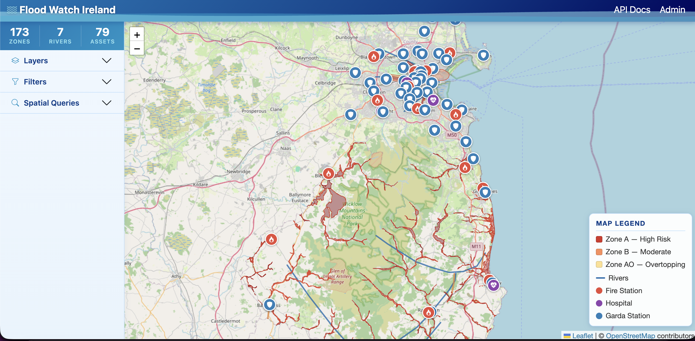
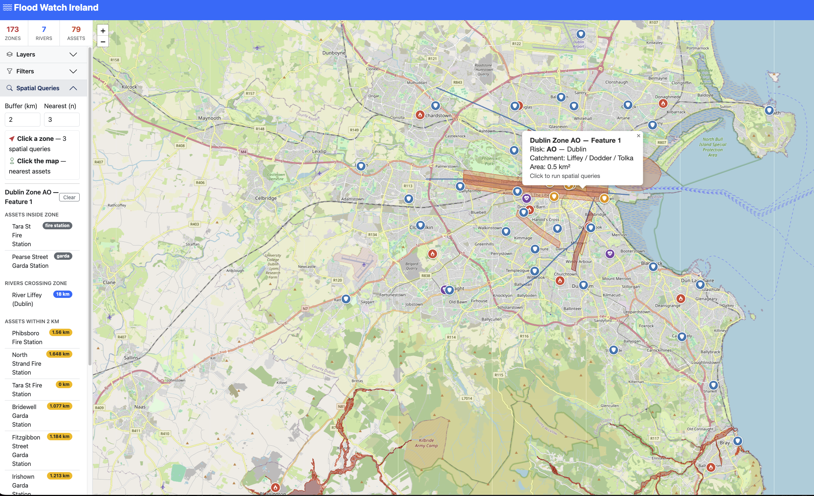
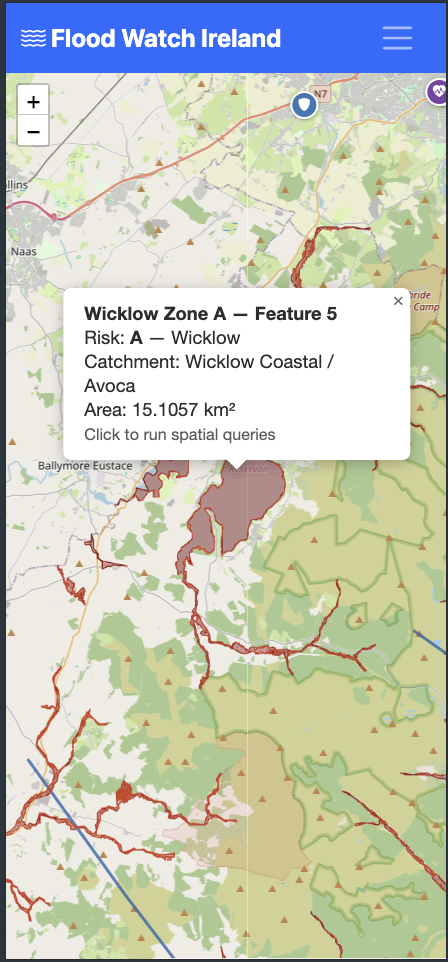
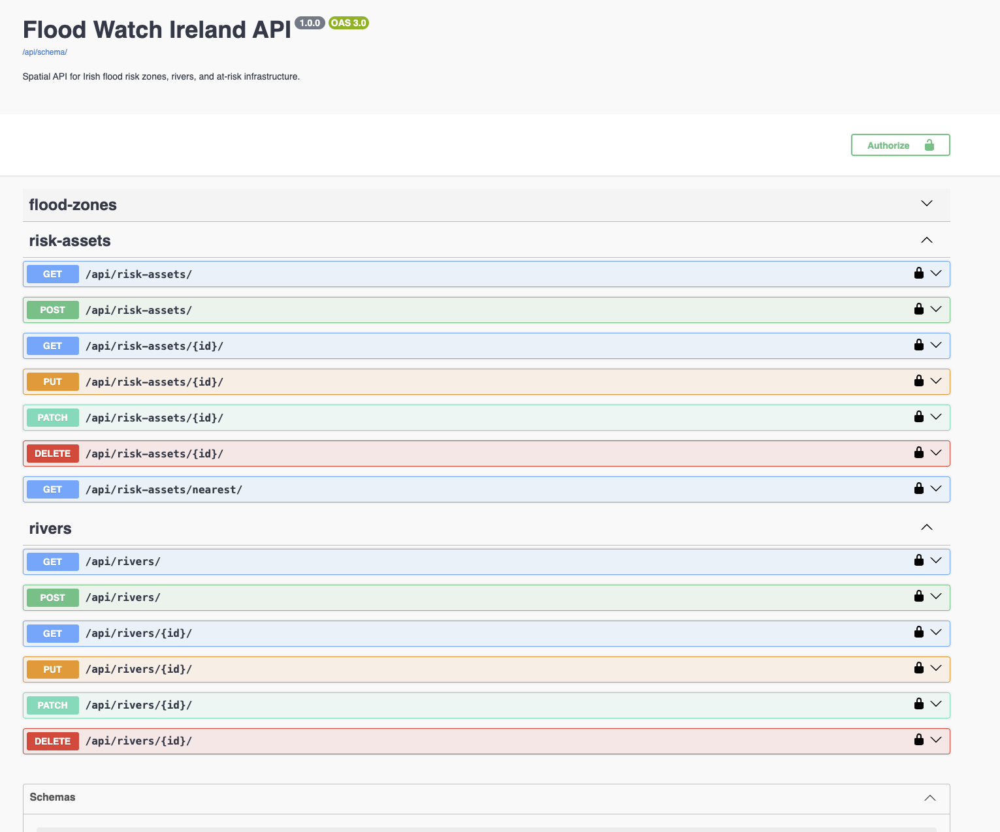

# Flood Watch Ireland

A location-based services web application for exploring Irish flood risk zones, rivers, and critical infrastructure. Built with Django and PostGIS, visualised with Leaflet.js, and fully containerised with Docker.



---

## Application Description & Features

Flood Watch Ireland lets you interactively explore flood risk data across Ireland:

- View flood zones (Zone A high risk, Zone B moderate, Zone AO overtopping) as colour-coded polygons
- See rivers and at-risk infrastructure — hospitals, fire stations, and Garda stations — on the same map
- Filter by risk level, county, and asset type
- Run four PostGIS spatial queries from the map:
  - **Assets inside a zone** — click any flood zone to see which critical services fall within it
  - **Rivers crossing a zone** — which rivers intersect the selected zone
  - **Buffer search** — find assets within a configurable radius (km) of a zone
  - **Nearest assets** — click anywhere on the map to find the closest infrastructure to that point
- Full CRUD operations via the REST API and Django Admin
- Responsive design — works on desktop, tablet, and mobile

---

## Technology Stack

| Layer | Technology |
|---|---|
| Database | PostgreSQL 16 + PostGIS 3.4 |
| Backend | Django 5, GeoDjango, Django REST Framework |
| API | DRF ViewSets + drf-spectacular (Swagger) |
| Frontend | Leaflet.js 1.9.4, Bootstrap 5.3, Bootstrap Icons |
| Tile Provider | OpenStreetMap |
| Containerisation | Docker Compose — 4 services |
| Reverse Proxy | Nginx |
| DB Management | pgAdmin 4 |

---

## Setup Instructions

### Prerequisites

- Docker Desktop installed and running
- Git

### 1. Clone the repository

```bash
git clone <your-repo-url>
cd "CA 1 - Web Mapping"
```

### 2. Create your environment file

```bash
cp .env.example .env
```

The defaults in `.env.example` work out of the box for local use.

### 3. Build and start all containers

```bash
docker compose up --build -d
```

### 4. Run migrations and load data

```bash
docker compose exec web python manage.py migrate
docker compose exec web python manage.py load_flood_data
docker compose exec web python manage.py load_risk_assets
docker compose exec web python manage.py collectstatic --noinput
```

### 5. Create an admin user (optional)

```bash
docker compose exec web python manage.py createsuperuser
```

### 6. Access the application

| Service | URL |
|---|---|
| Map application | http://localhost |
| Django Admin | http://localhost/admin/ |
| REST API / Swagger | http://localhost/api/docs/ |
| pgAdmin | http://localhost:5050 |

---

## Screenshots


*Main map view with flood zones, rivers, and risk assets*


*Spatial query results showing assets inside a zone and rivers crossing it*


*Responsive mobile layout with hamburger navigation*


*Swagger UI showing all REST endpoints including spatial queries*

---

## API Documentation

Full interactive docs at **http://localhost/api/docs/**

| Method | Endpoint | Description |
|---|---|---|
| GET/POST | `/api/flood-zones/` | List or create flood zones |
| GET/PUT/DELETE | `/api/flood-zones/{id}/` | Retrieve, update, or delete a zone |
| GET | `/api/flood-zones/{id}/assets-within/` | Spatial Q1 — assets contained within zone |
| GET | `/api/flood-zones/{id}/intersecting-rivers/` | Spatial Q2 — rivers intersecting zone |
| GET | `/api/flood-zones/{id}/buffer/?radius_km=2` | Spatial Q3 — assets within buffer radius |
| GET | `/api/risk-assets/nearest/?lat=&lng=&limit=3` | Spatial Q4 — nearest assets to a point |
| GET/POST | `/api/rivers/` | List or create rivers |
| GET/POST | `/api/risk-assets/` | List or create risk assets |

All list endpoints support `?search=`, `?county=`, `?risk_level=`, and `?ordering=` query parameters.

---

## Known Issues & Limitations

- Some OPW flood zone geometries contain self-intersections (invalid polygons). These are handled at query time using PostGIS `ST_MakeValid()` rather than fixing the source data, which adds a small overhead on zone-based queries.
- `ALLOWED_HOSTS` is restricted to `localhost` and `127.0.0.1`. For any public deployment this should be updated to the actual domain name.
- No user authentication on the API — all endpoints are open for read and write. Token-based authentication would be the next step for a production version.
- Real-time flood alerts are not supported. With access to OPW live gauge data or Met Éireann weather feeds, the app could trigger warnings when river levels approach flood thresholds — this would be a meaningful extension.
- The dataset covers Dublin and surrounding counties only. A full national dataset from OPW PFRA would allow the application to scale to all counties, but national-level data from OPW was not publicly available in a usable format at the time of development.
- Flood zone boundaries are static — they reflect historical risk modelling rather than live conditions. Integration with a dynamic flood modelling API, would make the risk assessment much more accurate.
