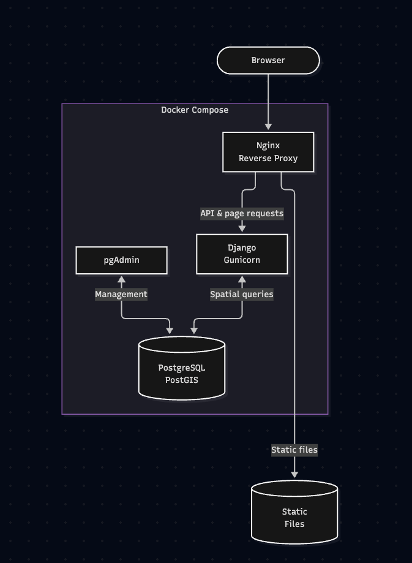
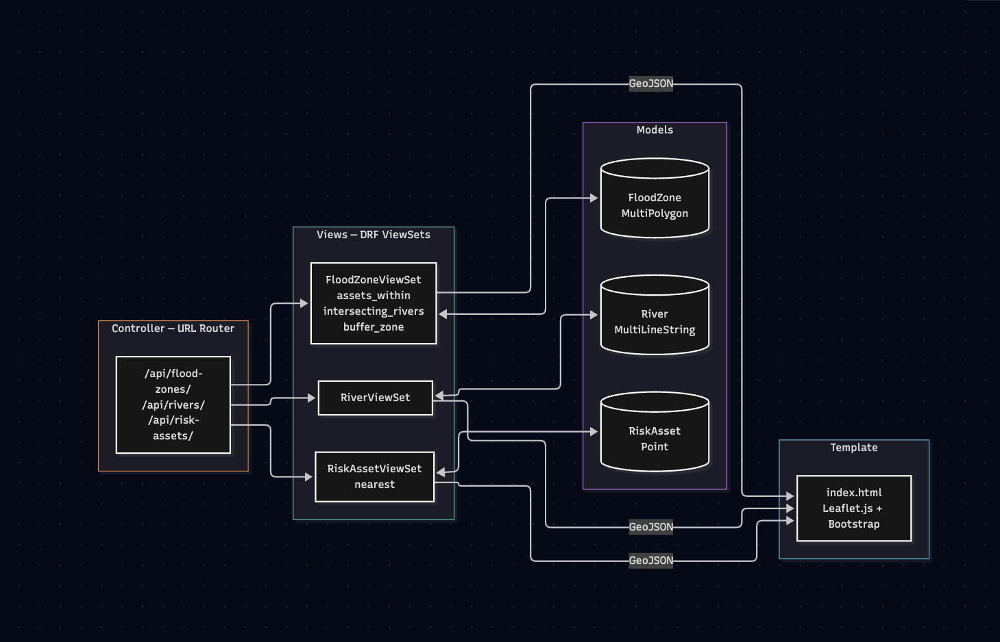

# Architecture — Flood Watch Ireland

## System Architecture



## MVC Architecture



---

## Component Overview

```
Browser (Leaflet.js + Bootstrap)
        │
        │  HTTP :80
        ▼
┌──────────────────────────────────────────────────────┐
│         Docker Network: flood_watch_net              │
│                   172.28.0.0/24                      │
│                                                      │
│  ┌─────────────┐        ┌──────────────────────┐    │
│  │    Nginx    │──────▶ │  Django / Gunicorn   │    │
│  │  :80        │        │  :8000               │    │
│  │             │        │                      │    │
│  │ /static/  ──┼──┐     │  - GeoDjango models  │    │
│  │ (volume)    │  │     │  - DRF ViewSets       │    │
│  └─────────────┘  │     │  - Spatial queries   │    │
│                   │     └──────────┬───────────┘    │
│  Static files     │                │                 │
│  served directly  │     ┌──────────▼───────────┐    │
│  from shared      │     │  PostgreSQL 16        │    │
│  Docker volume ───┘     │  + PostGIS 3.4        │    │
│                         │  :5432               │    │
│  ┌─────────────┐        │                      │    │
│  │  pgAdmin 4  │──────▶ │  - FloodZone table   │    │
│  │  :5050      │        │  - River table       │    │
│  └─────────────┘        │  - RiskAsset table   │    │
│                         │  - GiST indexes      │    │
│                         └──────────────────────┘    │
└──────────────────────────────────────────────────────┘
```

## Request Flow

1. Browser makes a request to **http://localhost** (port 80)
2. **Nginx** receives the request
   - If the path starts with `/static/` — serve the file directly from the shared volume (no Django involved)
   - All other requests — proxy to **Gunicorn** on port 8000
3. **Django** handles the request:
   - Template requests return `index.html`
   - API requests (`/api/...`) are routed to DRF ViewSets
   - Spatial query actions call **PostGIS** functions via GeoDjango ORM or raw SQL
4. **PostGIS** executes spatial operations (ST_Within, ST_Intersects, ST_MakeValid, Distance) and returns results
5. Django serialises the response as GeoJSON and returns it to the browser
6. **Leaflet.js** renders the GeoJSON on the map

## Docker Services

| Service | Image | Role |
|---|---|---|
| `db` | postgis/postgis:16-3.4 | Spatial database |
| `web` | Custom (Dockerfile) | Django + Gunicorn application server |
| `nginx` | nginx:1.25-alpine | Reverse proxy + static file serving |
| `pgadmin` | dpage/pgadmin4:9 | Database management UI |

All services share the `flood_watch_net` bridge network (172.28.0.0/24). The database is never exposed on a host port — only reachable within the Docker network.

## Data Persistence

| Volume | Contents |
|---|---|
| `postgis_data` | PostgreSQL data directory — survives container restarts |
| `static_volume` | Collected static files — shared between `web` and `nginx` |
| `pgadmin_data` | pgAdmin configuration and saved connections |
