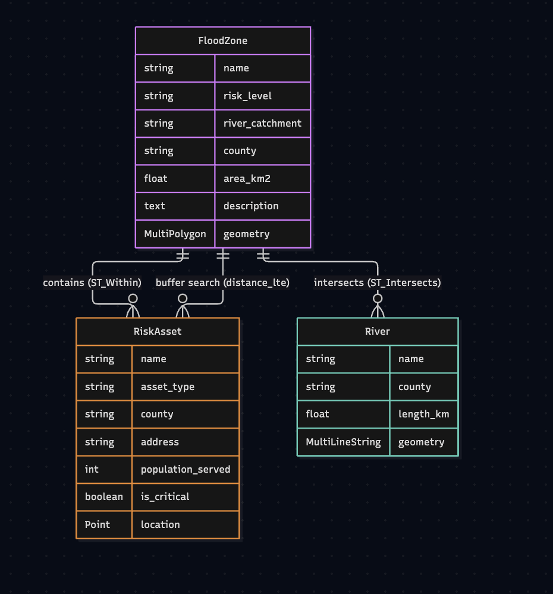

# Database Schema — Flood Watch Ireland

## Entity Relationship Diagram

---

## Overview

Three spatial tables, all using SRID 4326 (WGS84 — standard GPS coordinates). Each geometry column has an explicit GiST index for fast PostGIS spatial query performance.

---

## Table: flood_zones_floodzone

Stores flood risk zone polygons sourced from OPW Ireland PFRA data.

| Column | Type | Nullable | Notes |
|---|---|---|---|
| id | integer | NOT NULL | Auto primary key |
| name | varchar(255) | NOT NULL | Zone name |
| risk_level | varchar(2) | NOT NULL | A, B, or AO |
| river_catchment | varchar(255) | NOT NULL | River catchment name |
| county | varchar(100) | NOT NULL | Irish county |
| area_km2 | float | NOT NULL | Zone area in km² |
| description | text | YES | Optional description |
| geometry | MultiPolygon | NOT NULL | SRID 4326 |

**Indexes:**
- `floodzone_geometry_gist_idx` — GiST on `geometry` (spatial queries)
- `flood_zones_risk_le_54f0d3_idx` — BTree on `(risk_level, county)` (filter queries)

---

## Table: flood_zones_river

Stores river line geometries for rivers across Irish flood risk counties.

| Column | Type | Nullable | Notes |
|---|---|---|---|
| id | integer | NOT NULL | Auto primary key |
| name | varchar(255) | NOT NULL | River name |
| county | varchar(100) | NOT NULL | Irish county |
| length_km | float | NOT NULL | Length in km |
| geometry | MultiLineString | NOT NULL | SRID 4326 |

**Indexes:**
- `river_geometry_gist_idx` — GiST on `geometry` (spatial queries)
- `flood_zones_county_86bb07_idx` — BTree on `county` (filter queries)

---

## Table: risk_assets_riskasset

Stores critical infrastructure points — hospitals, fire stations, and Garda stations.

| Column | Type | Nullable | Notes |
|---|---|---|---|
| id | integer | NOT NULL | Auto primary key |
| name | varchar(255) | NOT NULL | Facility name |
| asset_type | varchar(20) | NOT NULL | fire_station, hospital, or garda |
| county | varchar(100) | NOT NULL | Irish county |
| address | varchar(255) | YES | Street address |
| population_served | integer | NOT NULL | Estimated population (default 0) |
| is_critical | boolean | NOT NULL | Critical infrastructure flag |
| location | Point | NOT NULL | SRID 4326 |

**Indexes:**
- `riskasset_location_gist_idx` — GiST on `location` (spatial queries)
- `risk_assets_asset_t_a98002_idx` — BTree on `(asset_type, county)` (filter queries)

---

## Spatial Queries

| Query | PostGIS Function | Tables |
|---|---|---|
| Assets inside zone | ST_Within + ST_MakeValid | flood_zones_floodzone, risk_assets_riskasset |
| Rivers crossing zone | ST_Intersects + ST_MakeValid | flood_zones_floodzone, flood_zones_river |
| Buffer search | distance_lte + D(km) via ORM | flood_zones_floodzone, risk_assets_riskasset |
| Nearest assets | Distance annotation + order_by | risk_assets_riskasset |

> **Note:** Some flood zone geometries from OPW contain self-intersections. `ST_MakeValid()` is called at query time to resolve these before spatial operations.

---

## Migrations

| App | Migration | Description |
|---|---|---|
| flood_zones | 0001_initial | Create FloodZone and River tables |
| flood_zones | 0002_... | Rename indexes |
| flood_zones | 0003_... | Add explicit GiST indexes |
| risk_assets | 0001_initial | Create RiskAsset table |
| risk_assets | 0002_... | Rename indexes |
| risk_assets | 0003_... | Update asset_type choices |
| risk_assets | 0004_... | Add explicit GiST index |
