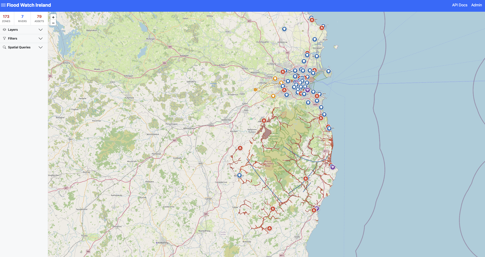
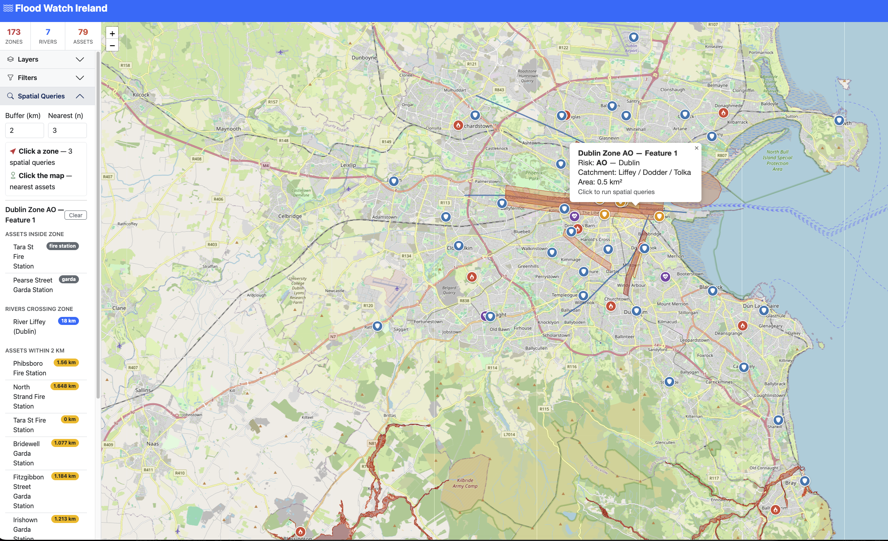
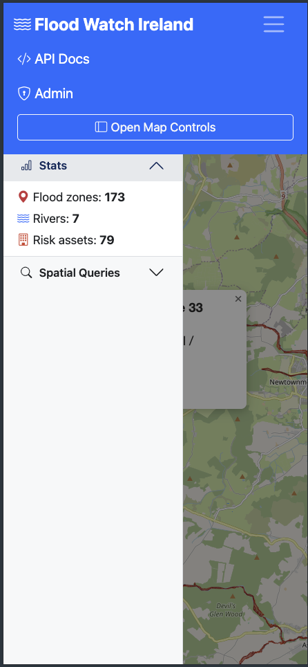
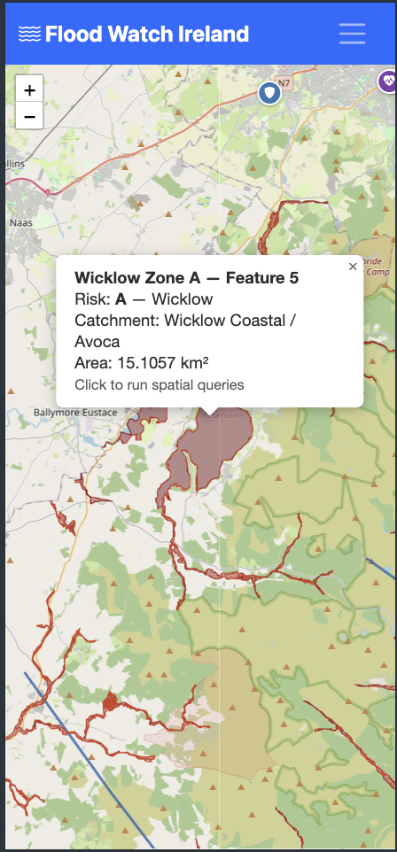
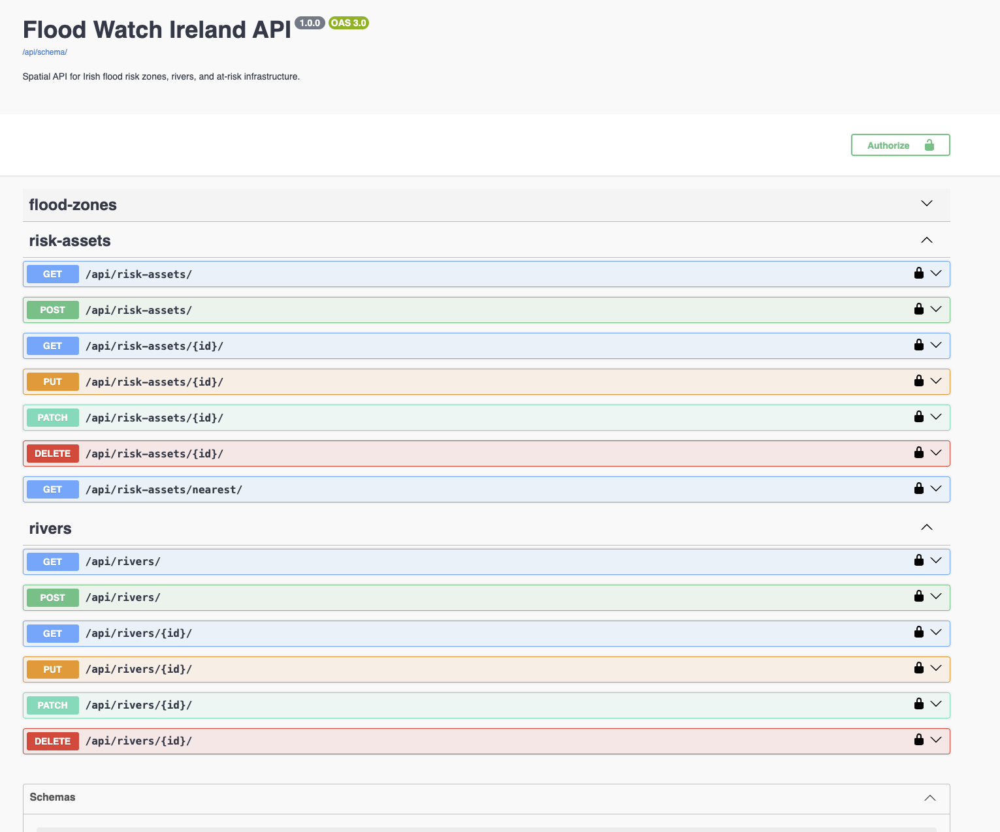

# User Guide — Flood Watch Ireland

## Getting Started

Open http://localhost in your browser. The map loads automatically centred on Dublin with all layers visible.

*Main application on desktop — sidebar on the left, interactive map on the right*

---

## The Map

- **Zoom** — use the +/- buttons (top left) or scroll wheel
- **Pan** — click and drag
- **Popups** — click any flood zone, river, or asset marker to see details

### Flood Zone colours

| Colour | Risk Level |
|---|---|
| Red | Zone A — High Risk |
| Orange | Zone B — Moderate Risk |
| Yellow | Zone AO — Overtopping Risk |

### Asset icons

| Icon colour | Type |
|---|---|
| Red circle | Fire Station |
| Purple circle | Hospital |
| Blue circle | Garda Station |

---

## Sidebar Controls

### Layers

Toggle flood zones, rivers, and risk assets on or off using the switches.

### Filters

Narrow down what's shown on the map:

- **Risk Level** — filter zones by Zone A, B, or AO
- **County** — show only data for a specific county
- **Asset Type** — filter by fire station, hospital, or Garda station
- **Reset** — clears all filters and reloads everything

---

## Spatial Queries

Set the buffer radius (km) and nearest asset limit in the Spatial Queries panel, then interact with the map.

*Query results showing assets inside a zone, rivers crossing it, and buffer search results*

- **Click a flood zone** — runs three queries automatically:
  1. Which assets are inside the zone
  2. Which rivers cross the zone
  3. Which assets are within your chosen buffer radius of the zone boundary
- **Click anywhere on the map** — finds the nearest assets to that point

Results appear in the sidebar under Spatial Queries. Click **Clear** to dismiss them.

---

## Mobile

Tap the hamburger icon (top right of the navbar) to open the navigation menu with links to API Docs, Admin, and the map controls sidebar.

*Hamburger menu open — showing navigation options and Open Map Controls button*

Tap **Open Map Controls** to slide in the full sidebar with layers, filters, and spatial queries.

*Mobile layout — full screen map with slide-in sidebar*

---

## Admin Panel

Go to http://localhost/admin/ to manage flood zones, rivers, and assets through a full GIS-enabled interface. You can create, edit, and delete spatial features with an interactive map widget.

---

## REST API

Go to http://localhost/api/docs/ for the full interactive Swagger API. All endpoints support GET. Flood zones, rivers, and risk assets also support POST, PUT, PATCH, and DELETE.

*Swagger UI — interactive API documentation with full CRUD and spatial query endpoints*
